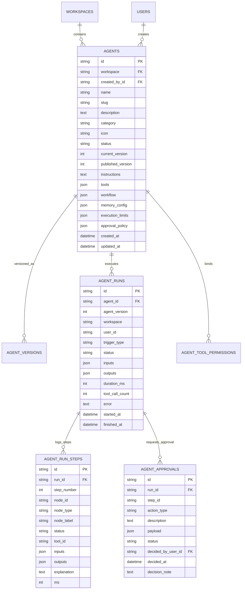

# PRECEDENT AGENT STUDIO — SYSTEM ARCHITECTURE & SPECIFICATION

**Status: PASS**  
**Version:** 1.0.0  
**Scope:** Prompt-to-Agent Visual Workflow Builder & Autonomous Governance Execution Engine  

---

## 1. Executive Summary

Precedent Agent Studio is an enterprise, native AI agent builder and workflow automation engine integrated into Precedent's AI-Assisted Brand Governance Platform. Inspired by n8n's visual node paradigm and powered by React Flow (`@xyflow/react`) and FastAPI, Agent Studio enables Brand Managers to describe custom compliance, triage, and auditing assistants in ordinary natural language. 

The application synthesizes validated agent configurations, binds registered enterprise tools, constructs executable DAG workflow graphs, allows visual fine-tuning, and safely executes workflows with deterministic safeguards and human approval checkpoints.

```
+-----------------------------------------------------------------------------------------+
|                                    PRECEDENT STUDIO                                     |
|                                                                                         |
|  +---------------------------+     Natural Language     +----------------------------+  |
|  | Natural Language Prompt   | =======================> | Structured Specification   |  |
|  | "Review marketing claims" |                          | (Pydantic / Tool Allowlist)|  |
|  +---------------------------+                          +----------------------------+  |
|               |                                                       |                 |
|               v                                                       v                 |
|  +---------------------------+                          +----------------------------+  |
|  | React Flow Visual Editor  | <======================= | DAG Workflow Graph         |  |
|  | Node Drag, Drop & Connect |                          | Triggers, Tools, AI, Human |  |
|  +---------------------------+                          +----------------------------+  |
|               |                                                       |                 |
|               v                                                       v                 |
|  +---------------------------+                          +----------------------------+  |
|  | Test Playground & Trace   |                          | Server Execution Engine    |  |
|  | Live inputs, tool latency |                          | Bounded execution, sandbox |  |
|  +---------------------------+                          +----------------------------+  |
|               |                                                       |                 |
|               +----------------------->[ APPROVAL ]<------------------+                 |
|                                         PAUSE POINT                                     |
|                                     (Brand Manager Sign-off)                            |
+-----------------------------------------------------------------------------------------+
```

---

## 2. Full-Stack Architectural Layers

### 2.1 Visual Builder Layer (Frontend)
- **Framework:** React 18, TypeScript, Tailwind CSS, `@xyflow/react`.
- **Canvas Nodes:**
  - `trigger`: Manual, Submission Created, Guideline Updated, Rule Changed, Scheduled.
  - `ai`: AI Intelligence, Claim Verification, Visual Findings Synthesis, Document Guidance.
  - `tool`: Enterprise safe tools with strict input/output contracts.
  - `logic`: Condition evaluation (e.g. `violations_count > 0`).
  - `human_approval`: Manager approval gatekeeper.
  - `output`: Final synthesis and structured payload delivery.
- **Panels:**
  - Left: Node Library grouped into 6 categories with click-to-add & drag capabilities.
  - Center: Interactive canvas with Minimap, Controls, Grid Background, edge reconnection, connection validation.
  - Right: Selected Node Configuration Inspector for parameters and tool allowlist bindings.
  - Top Toolbar: Save, Test, Publish, Undo/Redo, Version Status.

### 2.2 Agent Synthesis Layer (LLM & Heuristic Generator)
- **Primary Generator:** LLM completion (`/v1/chat/completions`) converting user requests into structured `AgentPromptSpec` conforming to a Pydantic schema.
- **Heuristic Architectural Fallback:** Deterministic semantic classifier extracting intent, selecting allowlisted tools, and generating complete node layouts and instructions when external LLM credentials are absent.
- **Strict Allowlist Filter:** Automatically rejects unregistered or dangerous tools before schema acceptance.

### 2.3 Workflow Execution Engine (Backend Runtime)
- **Framework:** FastAPI, SQLAlchemy 2.0 (ORM), SQLite/PostgreSQL.
- **Topological DAG Traversal:** Determines dependency execution order from trigger to output nodes.
- **Context passing:** Step outputs dynamically populate context data for downstream nodes.
- **Execution Limits:** Strict maximum step ceiling (`max_steps=10`) and timeout guard (`timeout_seconds=120`).
- **Prompt Injection Defense:** User copy and OCR text are wrapped in strict delimiters (`=== UNTRUSTED USER CONTENT ===`) to prevent instruction overriding.

### 2.4 Human-in-the-Loop & Governance Layer
- AI agents are strictly advisory. No agent can autonomously approve/reject content, alter rules, grant exceptions, or tamper with audit logs.
- Write actions trigger an automatic execution halt with status `waiting_for_approval`, persisting an `AgentApproval` record.
- Brand Managers review and decide via `POST /api/v1/agent-runs/{run_id}/approve`, resuming execution from the paused checkpoint.

---

## 3. Relational Database Architecture



---

## 4. API Specification & Routing

| Method | Endpoint | Description | Role Required |
| :--- | :--- | :--- | :--- |
| `POST` | `/api/v1/agents/draft-from-prompt` | Synthesizes agent spec & workflow from prompt | Manager |
| `GET` | `/api/v1/agents` | Lists workspace agents (filtered for creators) | Any (Isolated) |
| `POST` | `/api/v1/agents` | Creates an agent definition from scratch | Manager |
| `GET` | `/api/v1/agents/{id}` | Retrieves agent configuration and real stats | Any (Workspace) |
| `PATCH` | `/api/v1/agents/{id}` | Updates configuration or workflow nodes | Manager |
| `DELETE`| `/api/v1/agents/{id}` | Deletes / archives an agent | Manager |
| `POST` | `/api/v1/agents/{id}/validate` | Validates agent graph and tool allowlist | Any |
| `POST` | `/api/v1/agents/{id}/publish` | Creates immutable version and publishes | Manager |
| `POST` | `/api/v1/agents/{id}/pause` | Pauses agent automated triggers | Manager |
| `POST` | `/api/v1/agents/{id}/test` | Sandboxed execution in Test Playground | Manager |
| `POST` | `/api/v1/agents/{id}/execute` | Executes published agent with inputs | Creator / Manager |
| `GET` | `/api/v1/agent-runs` | Lists workspace execution history | Any (Workspace) |
| `GET` | `/api/v1/agent-runs/{id}` | Timeline view, step traces, and approvals | Any (Workspace) |
| `POST` | `/api/v1/agent-runs/{id}/cancel` | Aborts active or paused run | Any (Author) |
| `POST` | `/api/v1/agent-runs/{id}/approve` | Decides human approval and resumes run | Manager |
| `GET` | `/api/v1/agent-tools` | Registered safe tool catalogue | Any |
| `GET` | `/api/v1/agent-templates` | Ready-made template catalogue | Any |
| `POST` | `/api/v1/agent-templates/{id}/instantiate` | Clones template into workspace draft | Manager |

