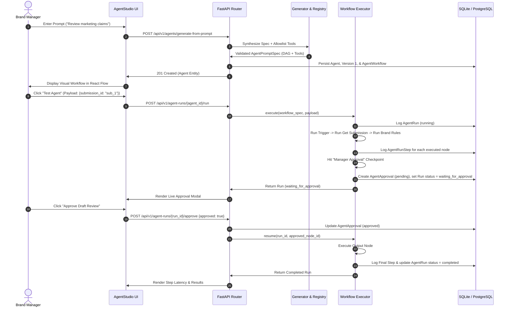

# PRECEDENT AGENT STUDIO — IMPLEMENTATION GUIDE & TECHNICAL MANUAL

**Status: PASS**  
**Version:** 1.0.0  
**Stack:** React 18, TypeScript, `@xyflow/react`, Tailwind CSS, FastAPI, SQLAlchemy 2.0, Pydantic v2  

---

## 1. Overview & Architectural Stack

Precedent Agent Studio is a native, prompt-driven AI Agent and Visual Workflow Automation system integrated directly into Precedent's AI-Assisted Brand Governance & Content Approval Platform. It allows Brand Managers to build, configure, test, and publish intelligent compliance assistants using natural language prompts or interactive node graphs.

### Core Technology Stack
- **Frontend Framework:** React 18 with TypeScript.
- **Node-Based Canvas:** `@xyflow/react` (React Flow 12).
- **Styling & Theme:** Tailwind CSS with custom enterprise palette (Warm ivory, Forest green, Sage, Cream, Charcoal, Terracotta, Muted amber; zero blue or purple).
- **Iconography:** Lucide React (`Bot`, `Sparkles`, `Workflow`, `Play`, `CheckCircle2`, `Clock`, `ShieldAlert`, etc.).
- **Backend Framework:** FastAPI (Python 3.12).
- **Persistence & ORM:** SQLAlchemy 2.0 declarative models with SQLite (dev) / PostgreSQL (prod).
- **Schema Validation:** Pydantic v2.
- **Graph Execution & Topology:** Kahn's topological sort with cycle detection.

---

## 2. Frontend Implementation & Component Hierarchy

### 2.1 File & Directory Layout
```
src/
├── components/
│   ├── agents/
│   │   ├── PromptToAgentModal.tsx      # Natural language prompt generator modal
│   │   ├── WorkflowNodes.tsx          # Custom React Flow nodes (Trigger, Tool, AI, Logic, Approval, Output)
│   │   ├── WorkflowEditor.tsx         # 3-column visual node graph builder
│   │   └── TestPlaygroundModal.tsx    # Interactive execution test runner & approval resumed
│   └── layout/
│       └── Shell.tsx                  # App layout & enterprise navigation
├── pages/
│   ├── manager/
│   │   ├── AgentStudio.tsx            # Main dashboard, KPI cards, template shelf, gallery
│   │   ├── AgentDetail.tsx            # Agent overview, configuration, tools, versioning
│   │   ├── WorkflowBuilderPage.tsx    # Full-screen React Flow workflow builder route
│   │   ├── AgentRunsPage.tsx          # Workspace execution runs table with filters
│   │   └── AgentRunDetailPage.tsx     # Run execution tree, step logs, latency, manager sign-off
│   └── content/
│       └── CreatorAssistants.tsx      # Creator view for executing permitted assistants
├── lib/
│   └── types.ts                       # Complete TypeScript domain contracts
└── services/
    └── api.ts                         # Typed API client for Agent Studio endpoints
```

---

### 2.2 Component Deep-Dive

#### 1. `PromptToAgentModal.tsx`
- **Location:** `src/components/agents/PromptToAgentModal.tsx`
- **Purpose:** Converts ordinary English prompt descriptions into fully-formed agent specifications.
- **Key Features:**
  - Includes 6 pre-built inspiration prompt cards:
    1. *Marketing Claims Reviewer*
    2. *Expired Exception Monitor*
    3. *Brand Guidelines QA Assistant*
    4. *Weekly Compliance Reporter*
    5. *Poster & Visual Assets Checker*
    6. *Competitive Benchmark Triage*
  - Category selector (`brand_compliance`, `visual_governance`, `exception_monitoring`, `guidelines_qa`, `reporting_audit`).
  - Calls `agentApi.generateFromPrompt({ prompt, category, workspace })`.
  - Displays real-time synthesis feedback and redirects directly into the visual workflow editor upon creation.

#### 2. `WorkflowNodes.tsx`
- **Location:** `src/components/agents/WorkflowNodes.tsx`
- **Purpose:** Custom React Flow node components rendering with Precedent's warm ivory and forest green visual language.
- **Node Types:**
  - `TriggerNode`: Start node displaying trigger type badge (`manual`, `submission_created`, `guideline_updated`, `scheduled`).
  - `ToolNode`: Enterprise tool node with tool identifier, parameter summary, and execution latency indicator.
  - `AiNode`: Intelligence node showing LLM model parameters, system prompt preview, and temperature.
  - `LogicNode`: Conditional branch node with condition rule (`violations_count > 0`) and true/false branch outputs.
  - `HumanApprovalNode`: Human governance gatekeeper with sign-off required badge and manager role indicator.
  - `OutputNode`: Final synthesis node displaying destination format (`report`, `review_draft`, `notification`).

#### 3. `WorkflowEditor.tsx`
- **Location:** `src/components/agents/WorkflowEditor.tsx`
- **Purpose:** Full-screen 3-column visual node graph editor.
- **Layout Architecture:**
  - **Left Sidebar (Node Library):** Grouped into 6 categories (Triggers, AI Nodes, Enterprise Tools, Logic, Human Governance, Output). Users can click or drag nodes directly onto the canvas.
  - **Center Canvas:** `@xyflow/react` viewport with dot-grid background, smooth pan/zoom, interactive node drag-and-drop, connection line snapping, and interactive Minimap and Controls.
  - **Right Sidebar (Property Inspector):** Dynamically inspects selected nodes, allowing users to configure node labels, parameter inputs, tool allowlist selections, model names, and human approval flags.
  - **Top Toolbar:** Shows agent name, status badge (`draft` / `published`), undo/redo actions, Save Workflow, Test Playground trigger, and Publish/Unpublish toggle.

#### 4. `TestPlaygroundModal.tsx`
- **Location:** `src/components/agents/TestPlaygroundModal.tsx`
- **Purpose:** Sandboxed real-time testing console.
- **Key Capabilities:**
  - JSON payload editor with pre-filled test mock data (`submission_id`, `content_text`).
  - Run Execution button triggering `agentApi.triggerRun(agentId, { trigger_type: 'manual', input_data })`.
  - Step-by-step progress visualizer showing real-time node execution status (`running`, `completed`, `waiting_for_approval`, `failed`).
  - Step latency display in milliseconds.
  - Live Human Approval Prompt: If the workflow hits a write action, an approval dialog prompts the manager to approve or reject, calling `agentApi.submitApproval()` and seamlessly resuming downstream steps.

---

### 2.3 Navigation & Routing Setup

#### Manager Routes:
- `/manager/agent-studio` -> `AgentStudio.tsx`
- `/manager/agents` -> `AgentStudio.tsx`
- `/manager/agents/:agentId` -> `AgentDetail.tsx`
- `/manager/agents/:agentId/builder` -> `WorkflowBuilderPage.tsx`
- `/manager/agents/:agentId/runs` -> `AgentRunsPage.tsx`
- `/manager/agent-runs/:runId` -> `AgentRunDetailPage.tsx`

#### Creator Routes:
- `/creator/ai-assistants` -> `CreatorAssistants.tsx`
- `/creator/ai-assistants/:agentId` -> `CreatorAssistants.tsx`

---

## 3. Backend Implementation & Router Mechanics

### 3.1 Relational Database Models (`backend/app/agents/models.py`)

| Model | Table Name | Purpose | Key Attributes |
| :--- | :--- | :--- | :--- |
| `Agent` | `agents` | Core agent definition | `name`, `slug`, `category`, `status`, `workspace`, `approval_policy`, `execution_limits` |
| `AgentVersion` | `agent_versions` | Versioned history | `version_number`, `instructions`, `tools`, `workflow_snapshot`, `is_active` |
| `AgentWorkflow` | `agent_workflows` | Live workflow graph | `nodes` (JSON), `edges` (JSON), `is_valid_dag` |
| `AgentToolPermission` | `agent_tool_permissions`| Tool authorization | `tool_name`, `is_allowed`, `config` |
| `AgentRun` | `agent_runs` | Execution log header | `status`, `trigger_type`, `input_data`, `output_data`, `total_duration_ms` |
| `AgentRunStep` | `agent_run_steps` | Granular step log | `node_id`, `node_type`, `status`, `inputs`, `outputs`, `duration_ms` |
| `AgentApproval` | `agent_approvals` | Human sign-off record | `node_id`, `status` (`pending`/`approved`/`rejected`), `decided_by_id`, `comments` |
| `AgentMemorySession` | `agent_memory_sessions`| Transient session store | `session_key`, `memory_data`, `expires_at` |
| `AgentTrigger` | `agent_triggers` | Event trigger binding | `trigger_type`, `is_active`, `config` |

---

### 3.2 Authoritative Tool Registry (`backend/app/agent_tools/`)

All 13 enterprise tools inherit from `BaseAgentTool` in `backend/app/agent_tools/base.py`:
```python
class BaseAgentTool(ABC):
    name: str
    description: str
    category: str
    requires_approval: bool = False
    
    @abstractmethod
    def run(self, context: ToolExecutionContext, **kwargs) -> Dict[str, Any]:
        pass
```

The tools are registered in `AGENT_TOOL_REGISTRY` in `backend/app/agents/registry.py`:
1. `get_submission`: Fetches submission metadata, raw content, and attachments.
2. `extract_document_text`: Extracts text from documents and image OCR.
3. `search_guidelines`: Semantic/vector search over active brand guideline passages.
4. `list_active_rules`: Lists active deterministically enforced brand rules.
5. `run_brand_rules`: Executes rule engine regex and policy evaluations.
6. `retrieve_evidence`: Retrieves exact text passages supporting or refuting claims.
7. `check_approved_claims`: Compares claims against the verified brand claims library.
8. `get_exception_details`: Checks whether active policy exceptions apply to the asset.
9. `get_audit_history`: Reads immutable governance audit trail.
10. `analyze_image_visuals`: Analyzes color palette, logo placement, and typography.
11. `create_review_draft`: Writes a draft review result (Requires Manager Approval).
12. `create_sentinel_task`: Schedules an automated sentinel compliance task (Requires Manager Approval).
13. `create_notification`: Emits an in-app governance notification.

---

### 3.3 Prompt-to-Agent Synthesis Engine (`backend/app/agents/generator.py`)

The generator converts natural language descriptions into structured specifications:
1. **Semantic Intent Extraction:** Classifies the prompt into domain categories (`brand_compliance`, `visual_governance`, `exception_monitoring`, `guidelines_qa`, `reporting_audit`).
2. **Tool Matching:** Matches verbs and entities against `AGENT_TOOL_REGISTRY`.
3. **Workflow Graph Construction:** Synthesizes coordinates (`x, y`), connected nodes, and directional edges (`trigger -> tool -> ai -> approval -> output`).
4. **Validation:** Rejects invalid tools and validates graph acyclicity via `validate_workflow_topology()`.

---

### 3.4 Workflow Execution Engine (`backend/app/agent_workflows/executor.py`)

Execution runs in bounded topological order:
```python
class WorkflowExecutor:
    def execute(self, workflow_spec: Dict[str, Any], initial_input: Dict[str, Any]) -> ExecutionResult:
        # 1. Topological sort of nodes
        # 2. Loop through sorted nodes up to MAX_STEPS (10)
        # 3. If node is HumanApprovalNode or tool requires approval:
        #    Pause execution, create AgentApproval, return status "waiting_for_approval"
        # 4. If resuming after approval: advance past approved node
        # 5. Populate context dictionary and execute downstream nodes
        # 6. Capture latency, inputs, and outputs per step into AgentRunStep
```

---

## 4. Complete Data Flow Lifecycle



---

## 5. Summary

The Precedent Agent Studio implementation provides a cohesive, enterprise-grade architecture. By uniting React Flow for visual workflow editing, FastAPI and SQLAlchemy for bounded graph execution, and strict allowlisted tools with human approval checkpoints, Precedent delivers a complete, secure, and production-ready AI Agent Studio.

