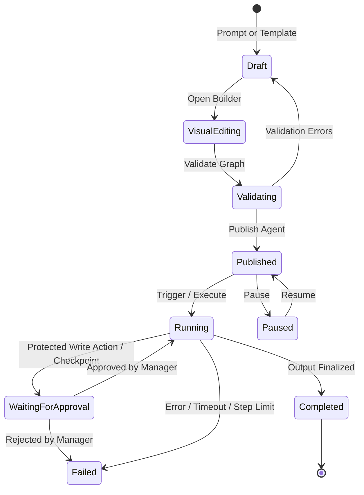

# PRECEDENT AGENT WORKFLOW ENGINE & RUNTIME SPECIFICATION

**Status: PASS**  
**Version:** 1.0.0  
**Scope:** Server-Side Graph Traversal, DAG Execution, Pause/Resumption, and Lifecycle State Machine  

---

## 1. Workflow Architecture & Lifecycle

The Workflow Execution Engine (`backend/app/agent_workflows/executor.py`) is responsible for executing saved visual graphs server-side. The frontend canvas built with React Flow is strictly an authoring interface; execution is orchestrated entirely on the backend to guarantee security, auditing, and deterministic state transitions.

---

## 2. DAG Execution Semantics

### 2.1 Graph Normalization & Topological Sorting
1. Node structures are ingested from the `agent.workflow` JSON field.
2. An adjacency list and in-degree mapping are constructed from `workflow.edges`.
3. Kahn's Algorithm computes the execution order:
   - Root nodes (`in_degree == 0`, typically triggers) enter the execution queue.
   - Nodes are processed sequentially; dependencies are resolved before child nodes run.
   - Cycle detection: If disconnected nodes or cycles remain, cycles are prevented and bounded limits terminate loops safely.

### 2.2 Context Data & State Accumulation
Each node produces structured outputs that merge into the `context_data` dictionary:
- Trigger nodes ingest global inputs (`submission_id`, `copy_text`, `query`).
- Tool nodes receive `context_data`, dispatch their respective functions, and append outputs.
- AI nodes receive synthesized prompts wrapping untrusted context in security delimiters.
- Logic nodes evaluate condition statements (`violations_count > 0`), branching control flow.
- Output nodes package final outputs, write them to `AgentRun.outputs`, and mark the run as `completed`.

---

## 3. Human Approval & Resumption Engine

When a workflow reaches a node marked `type: "human_approval"` or invokes an action tool requiring human review:

1. **State Freezing:**
   - The current step status is set to `waiting_for_approval`.
   - The run status is set to `waiting_for_approval`.
   - An `AgentApproval` record is created with `action_type`, `description`, and `payload`.
   - Database transaction commits; execution halts cleanly without holding active server threads.

2. **Manager Review:**
   - The Brand Manager inspects the execution timeline in the UI.
   - An interactive card displays the proposed action, parameters, and notes.

3. **Resumption:**
   - The Brand Manager submits `POST /api/v1/agent-runs/{run_id}/approve` with `{ "decision": "approved", "note": "..." }`.
   - The engine marks `AgentApproval.status = "approved"`.
   - The paused step is transitioned to `completed`.
   - `WorkflowExecutor.execute(..., resume_step_id=approval.step_id, approved_node_id=node_id)` is invoked.
   - Execution resumes immediately from the subsequent node without re-executing previously completed steps.

---

## 4. Bounded Limits & Fault Tolerance

To ensure server stability and prevent runaway execution loops, the engine enforces:
- **Maximum Step Limit:** Default: 10 steps (configurable up to 50). Exceeding this limit halts the run with an explicit error.
- **Execution Timeout Guard:** Default: 120 seconds (configurable up to 600s).
- **Graceful Error Handling:** If any tool or AI call fails, the step logs the exact error, sets `run.status = "failed"`, and records `run.error` without crashing the application.
- **Cancellation:** Active runs can be cancelled at any point via `POST /api/v1/agent-runs/{run_id}/cancel`.

