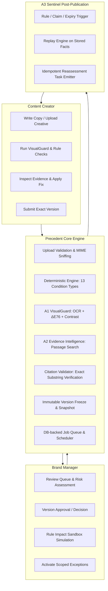

# PRECEDENT — Technical Architecture

**Product:** Precedent — AI-Assisted Brand Governance & Content Approval Platform  
**Team:** We Code Coders  
**Core Thesis:** *Deterministic rules decide. AI suggests. Humans approve.*

---

## 1. Architectural Philosophy

Precedent divides brand governance into three decoupled layers:
1. **Deterministic Rule Engine (Pure Python):** Pure functions with zero I/O, zero network dependencies, and zero LLM calls. It is the sole authority for official rule outcomes (`violation`, `compliant`, `unknown`).
2. **Advisory Pipelines (Computer Vision & Retrieval):**
   - **A1 VisualGuard:** Normalizes creative assets, extracts OCR text, measures layout margins and WCAG AA contrast, and calculates CIE-Lab ΔE76 color distance to the official Brand Kit.
   - **A2 Evidence Intelligence:** Chunks guideline PDFs and DOCX files into indexed passages, performs hybrid lexical and vector retrieval, and enforces strict citation verification (verifying that any quote matches stored text before being shown).
   - **A3 Sentinel:** Continuously monitors approved and published assets, replaying stored facts whenever policies, claims, or exceptions change.
   - **Review Crew:** Multi-agent advisory pipeline (Intake, VisualGuard, Retrieval, Evidence Verifier, Synthesis) operating under read-only/draft-only boundaries.
3. **Human Approval Authority:** Brand Managers decide on exact, immutable versions. Approvals bind to snapshot hashes of the rules and exceptions in force.

---

## 2. Technology Stack

- **API Framework:** FastAPI on Python 3.12, Pydantic v2 schemas, SQLAlchemy 2.0 ORM, Alembic migrations.
- **Database:** PostgreSQL 16 (production container) with dual-dialect SQLite portability (unit tests).
- **Authentication:** Server-side Argon2 (`argon2-cffi`) password hashing and signed HS256 JWT tokens with workspace tenancy isolation.
- **Job Processing:** DB-backed `jobs` table polling worker with `SELECT ... FOR UPDATE SKIP LOCKED` and synchronous test mode (`JOBS_INLINE=true`).
- **Scheduler:** Standalone process running APScheduler for daily Sentinel scans and exception expiry sweeps.
- **Computer Vision & OCR:** RapidOCR / OpenCV + Pillow with custom CIE-Lab ΔE76 color difference and WCAG AA contrast ratio algorithms.
- **Document Ingestion:** PyMuPDF (`fitz`) and `python-docx` chunking pages into paragraph-indexed `guideline_passages`.
- **Frontend:** React 18, TypeScript, Vite, Tailwind CSS, Lucide icons, and React Router.

---

## 3. Data Integrity & Concurrency

- **Immutable Content Versions:** Once a submission version is submitted or approved, it is frozen with a SHA-256 content hash. Edits always increment to version $N+1$.
- **Decision Transactions:** Version reviews execute within an atomic transaction. Stale review submissions return HTTP 409 (`STALE_VERSION`).
- **Append-Only Audit Log:** Every login, mutation, decision, exception, and publication writes an `audit_events` record.
- **Idempotent Sentinel Tasks:** Unique constraint `(submission_version_id, trigger_type, trigger_ref)` guarantees that running scans repeatedly never produces duplicate tasks.

